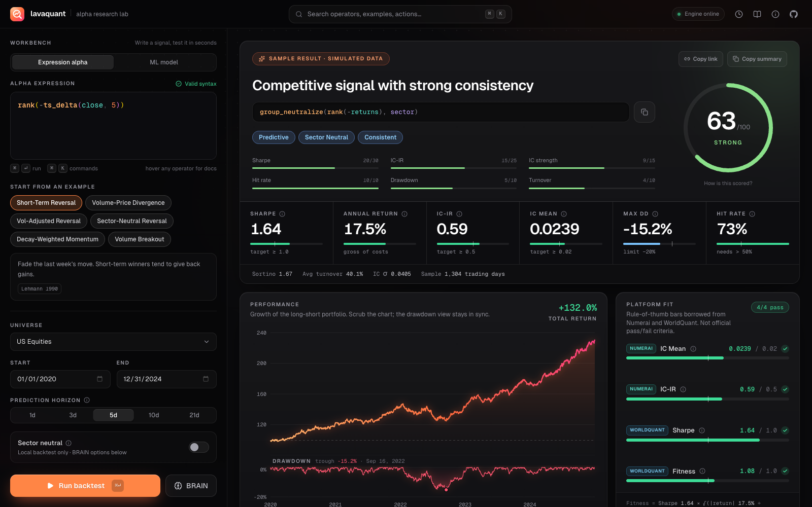

# LavaQuant

Alpha research lab. Write WorldQuant-style expressions, backtest them, compare against BRAIN and Numerai. Next.js + FastAPI + LightGBM.

Unaffiliated with WorldQuant.

Live: [quant.drew.fun](https://quant.drew.fun)



The result on first load is simulated sample data. Run a backtest for real numbers.

## What it does

Type an alpha like `group_neutralize(rank(-returns), sector)`, hit run, get IC, Sharpe, drawdown and a few charts in about 10 seconds.

- Editor with highlighting, autocomplete and live error checking
- Backtests on an S&P 500 sample, sector ETFs, forex and commodities
- Optional submit to WorldQuant BRAIN to compare scores
- LightGBM / ridge models with time-series CV
- Risk: VaR and CVaR three ways, a rolling VaR backtest, and stress scenarios (see below)
- Cmd+K palette, and shareable links (`?alpha=...`) that open and run an alpha

## Metrics

Full definitions are in the app under Docs.

| | |
|---|---|
| IC | Daily rank correlation between the alpha and forward returns |
| IC-IR | mean(IC) / std(IC). Daily, not annualized |
| Sharpe | mean / std of daily return, times √252 |
| Turnover | Share of the book traded per day |
| Fitness (est.) | Sharpe × √(\|return\| / max(turnover, 0.125)), WorldQuant's formula on local numbers |
| Score | 0-100 blend of the above. My own heuristic, not an industry metric |
| VaR / CVaR | Daily loss a bad day should not beat at 95% and 99%, and the average loss on the days that do |

## Risk

Every backtest also gets a risk report, computed from the portfolio's daily P&L (`backend/app/engine/risk.py`):

- **VaR and CVaR** at 95% and 99%: historical, Gaussian, and Monte Carlo from a fitted Student-t. The gap between the Gaussian and the others is the fat-tail effect.
- **10-day horizon** VaR and CVaR by resampling days, Gaussian √time scaling, and Monte Carlo.
- **VaR backtest:** a historical VaR rolled forward daily from the prior 250 days, with a Kupiec test (do breaches come as often as promised?) and a Christoffersen test (do they bunch together?).
- **Stress:** the worst 1-day, 1-week, 1-month and 3-month stretches, how the strategy did in named market-stress windows the backtest covers (COVID, 2022, March 2023), and VaR at 1.5×, 2× and 3× volatility.

Multi-day figures treat days as independent, and the named windows are market episodes, not shocks to this strategy's own factors. The gallery files and the sample result carry a precomputed report. After changing either, refresh it with `backend/scripts/backfill_risk.py` (the command for the sample is in `frontend/scripts/dump-featured.mjs`).

Worth knowing:

- Returns are gross of costs.
- The "platform fit" thresholds are rules of thumb, not official Numerai or WorldQuant criteria.
- Local data is a ticker sample from Yahoo. It won't match BRAIN's numbers, which is why the BRAIN button exists.

## How it's built

Next.js on Vercel calls a FastAPI backend on Google Cloud Run. The DSL is parsed with `ast` against a function whitelist, no `eval`. BRAIN logins pass through the backend per request and aren't stored or logged.

## Run locally

Python 3.9+ and Node 18+.

```bash
cd backend
python3 -m venv .venv && source .venv/bin/activate
pip install -r requirements.txt
uvicorn app.main:app --reload
```

```bash
cd frontend
npm install
npm run dev
```

Frontend is on :3000, backend on :8000.

Backend tests (the risk module, against closed-form and textbook values):

```bash
cd backend
.venv/bin/python -m unittest discover -s tests -t .
```

## Deploy

Vercel with root `frontend`. The backend is the Dockerfile in `backend`, on Cloud Run (scales to zero, so it costs about nothing when idle):

```bash
cd backend
gcloud run deploy lavaquant-api --project lavaquant-drew --source . --region us-central1 \
  --allow-unauthenticated --port 8000 --cpu 2 --memory 2Gi --timeout 300 \
  --max-instances 2 --min-instances 0 --concurrency 4
```

`.gcloudignore` keeps the local `.venv` out of the upload. A backtest peaks near 300 MB and takes 3 to 25 seconds, so 2 GiB is generous. `max-instances 2` caps the bill if the endpoint is hammered. `railway.json` is left over from the earlier Railway deploy and is not used.

| Variable | Where | |
|---|---|---|
| `NEXT_PUBLIC_API_URL` | Frontend | Backend URL, e.g. `https://lavaquant-api-1050413238132.us-central1.run.app` |
| `NEXT_PUBLIC_SITE_URL` | Frontend | Public URL, for link previews |
| `ALLOWED_ORIGINS` | Backend | Comma-separated CORS origins. Has defaults |
| `CACHE_DIR` | Backend | Price data cache. Optional |

`NEXT_PUBLIC_*` is baked in at build time, so redeploy after changing it.

## Limitations

- Prices come live from Yahoo and the cache is wiped on deploy, so the first request after one is slow.
- No costs, slippage or borrow fees.
- ML CV only trains on data before each validation fold, with an embargo gap. Not a full purged k-fold.

Research only, not investment advice.
